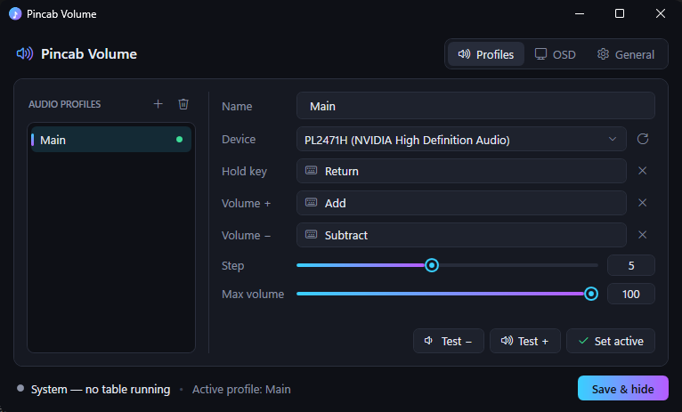

<div align="center">

# 🔊 Pincab Volume

### *Tilt-free volume control for your virtual pinball cabinet* 🎰


**Every table remembers its own volume. Your flippers control the sound. A slick OSD shows you where you're at.**



</div>

---

## 🤔 Why?

You know the drill: *Attack from Mars* blasts your eardrums 💥, the next table whispers like a library 📚, and the
volume knob is somewhere behind the cabinet, under three cables and a spider 🕷️.

**Pincab Volume** sits quietly in your tray, watches for **Visual Pinball X** tables launched from
**PinUP Popper** (or anything else), and:

- 🎚️ lets you change the volume with **any key or gamepad button**: your cab buttons, a hidden switch, an encoder…
- 🧠 **remembers the volume per table** and restores it the moment that table starts
- 🏠 goes back to your **system volume** as soon as you quit a table
- 📺 pops a **gorgeous OSD** over the playfield, rotated and positioned wherever you want

---

## ✨ Features

| | |
|---|---|
| 🎧 **Multi-device profiles** | One profile per audio output: playfield speakers, backbox, exciters/shakers… each with its own keys. |
| ⌨️ **Keyboard & 🎮 XInput** | Bind single keys, combos (`Ctrl + F5`) or pad combos (`LB + DPad Up`). Pad buttons auto-repeat when held. |
| ✋ **Hold keys** | Share the same Volume +/− buttons between profiles: hold a key/button to pick which device you're adjusting. |
| 🧠 **Per-table memory** | Volume is saved per table *and* per profile, plus a **System** volume for when nothing is running. |
| 📺 **Rotatable OSD** | 0° / 90° / 180° / 270°, 9 anchor points, pixel offsets, scale and duration. Click-through and never steals focus. |
| 🔒 **Max volume cap** | Protect your speakers (and your neighbours 🏘️) with a per-profile ceiling. |
| 🌙 **Dark UI** | Compact, custom-themed dark settings window. No eye-searing white boxes at 2 AM. |
| 🫥 **Tray app** | Starts minimized (once configured), lives in the tray, optional *run at logon*. |
| 🛡️ **No admin rights** | Per-user hooks, Core Audio API and `HKCU` only. |

---

## 🚀 Getting started

### 1️⃣ Requirements

- 🪟 Windows 10 / 11
- ⚙️ [.NET 10 Desktop Runtime](https://dotnet.microsoft.com/download/dotnet/10.0) (x64)
- 🎱 Visual Pinball X (VPX). PinUP Popper or any other frontend works too.
- 📺 For the OSD to appear over the table, run VPX in **windowed fullscreen** (not exclusive fullscreen).

### 2️⃣ Build

```powershell
git clone <this repo>
cd PincabVolume
dotnet build -c Release
```

The app ends up in `bin\Release\net10.0-windows\PincabVolume.exe`. 🎉

### 3️⃣ First launch

On the very first run, the settings window opens automatically:

1. 🎧 **Profiles** → click **＋**, pick your **Device**, and capture your **Volume +** / **Volume −** keys.
2. 🧪 Hit **Test +** / **Test −** to hear it work (and see the OSD!).
3. 📺 **OSD** → choose the monitor (your playfield 😉), rotation and position. Every change previews live.
4. ⚙️ **General** → tick **Run at Windows logon** if you want it always ready.
5. 💾 **Save & hide**, and it tucks itself into the tray.

> 💡 **Tip:** to capture a binding, click the field and press the key / pad buttons. Pad combos are committed when you
> release all the buttons. Press **Esc** to cancel.

---

## 🎮 How bindings work

```
Volume +  = Add                  →  press "Add" anywhere: volume goes up
Hold key  = Return
Volume +  = Add                  →  only while "Return" is held
Volume +  = Pad:LB+DPadUp        →  hold LB, press DPad Up 🎮
```

- 🔑 **No hold key:** the binding works on its own.
- ✋ **With a hold key:** the binding only fires while the hold key is down, and it takes priority. Great for using
  your cab's flipper buttons as volume buttons *only* while holding Start, or for driving several devices with the
  same buttons.

---

## 🧠 How table detection works

Pincab Volume polls the windows every ¾ second 👀:

| VPX state | Detected as |
|---|---|
| 🎱 Player window open (`VPPlayer` / *"Visual Pinball Player"*) | ▶️ **Table running**, name taken from the editor title `Visual Pinball - [Table Name]` |
| 📝 Only the editor is open (table quit) | 🏠 **System** |
| 💤 VPX not running | 🏠 **System** |

When the context changes, every profile's volume is restored from memory (capped at its max volume), and the OSD
shows the active profile's level. 🔁

If you change the volume during a table, that table remembers it. A table you never adjusted simply uses the System
volume. 🤷

---

## 📺 OSD tuning cheat-sheet

| Setting | What it does |
|---|---|
| 🖥️ Monitor | Which screen gets the OSD (pick the playfield!) |
| 🔄 Rotation | Match your playfield orientation: cabinets usually want **90°** or **270°** |
| 📍 Position | 3×3 anchor grid: corners, edges or dead center |
| ↔️ Offset X / Y | Pixels away from the anchored edge (negative = pull inward) |
| 🔍 Scale | 0.5× → 4×, for 4K playfields 😎 |
| ⏱️ Duration | How long it stays before fading out |

---

## 🗂️ Where's my stuff?

All settings and per-table volumes live in one human-readable file 📄:

```
%APPDATA%\PincabVolume\config.json
```

You can open it from **General → 📂**. Want to forget a table's volume? Select it in **Saved table volumes** and hit
🗑️.

---

## 🛠️ Troubleshooting

<details>
<summary>❌ <b>"You must install .NET to run this application"</b></summary>

Install the **.NET 10 Desktop Runtime (x64)**. If you only have the SDK installed in a custom folder (e.g.
`%USERPROFILE%\.dotnet`), either set `DOTNET_ROOT` to that folder or launch with `dotnet PincabVolume.dll`.
</details>

<details>
<summary>👻 <b>The OSD doesn't show over the table</b></summary>

VPX must run in **windowed fullscreen**. Exclusive fullscreen draws over every other window. Also check that the OSD
is enabled and that the right monitor is selected (use **Preview**).
</details>

<details>
<summary>🔇 <b>Keys do nothing while VPX is focused</b></summary>

If VPX runs **as administrator**, Windows won't let a non-admin app see its key presses. Run both at the same
level (ideally both *not* elevated).
</details>

<details>
<summary>🎧 <b>My device shows "(unavailable)"</b></summary>

The device was unplugged or disabled. Plug it back in and hit the ⟳ refresh button next to the device list.
</details>

<details>
<summary>🎱 <b>The table is never detected</b></summary>

Check the bottom status bar in the settings window while a table is running. It should show the table name with a
green dot 🟢. Detection needs VPX's player window and its `Visual Pinball - [Table]` editor window.
</details>

---

## 🧬 Project layout

```
PincabVolume/
├── 📄 App.xaml(.cs)            startup, single instance, wiring
├── 📁 Core/
│   ├── AudioService.cs         Core Audio volume per device (NAudio)
│   ├── ConfigService.cs        JSON config with debounced saves
│   ├── InputService.cs         low-level keyboard hook + XInput polling
│   ├── Models.cs               profiles, OSD settings, config
│   ├── Native.cs               Win32 interop
│   ├── StartupService.cs       run at logon (HKCU)
│   ├── TableDetector.cs        "which table is playing?"
│   ├── TrayIcon.cs             tray icon + dark menu
│   └── VolumeManager.cs        bindings → volume, per-table memory
├── 📁 Converters/              XAML value converters
├── 📁 Themes/Dark.xaml         the custom dark theme 🌙
└── 📁 Views/                   settings window, OSD, binding picker
```

**Built with** 💜 C# · .NET 10 · WPF · [NAudio](https://github.com/naudio/NAudio)

---

<div align="center">

### 🎰 Now go get that extra ball, at the *right* volume. 🔊✨

</div>
